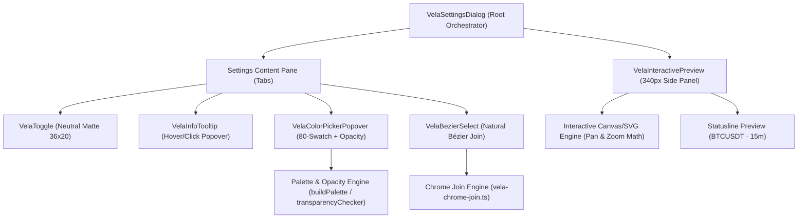

# ADR-002: Fidelidade Visual e Funcional 1:1 do Modal de Configurações Vela

**Status**: Aprovado para Implementação  
**Data**: 2026-10-09  
**Autor**: Senior Software Architect (ECC Ecosystem)  
**Contexto**: TradeJournal Web (`apps/web/src/components/settings/vela-settings-dialog.tsx`)  
**Referência Master**: LuxAlgo Vela Chart (`https://vela.luxalgo.com/chart/bz6aq020segz2hv1fmqsd77l`)  
**Evidências Visuais**: Capturas de tela reais em `/tmp/temp-images/` (`print_20261009_140056.png`, `print_20261009_140217.png`, `print_20261009_140301.png`, `print_20261009_140412.png`, `print_20261009_140521.png`, `print_20261009_140609.png`)  

---

## 1. Sumário Executivo & Diagnóstico

O modal de configurações do TradeJournal (`vela-settings-dialog.tsx`) atua como a central de controle visual e operacional do motor gráfico Vela. Embora a estrutura básica estivesse funcional, uma auditoria comparativa direta contra a referência master oficial da LuxAlgo revelou 5 discrepâncias críticas de alta visibilidade:

| Componente | Estado Atual (Legado) | Referência Master Oficial LuxAlgo Vela | Impacto / Severidade |
| :--- | :--- | :--- | :--- |
| **Info Tooltip** | `span` estático simples posicionado no label, sem popover | Botão `[ i ]` circular arredondado (18x18px) posicionado imediatamente antes do switch, abrindo popover escuro elegante com badge squircle, título em negrito, divisor e descrição completa | Alto (Usabilidade e UX) |
| **Color Picker** | Seletor nativo `<input type="color">` do navegador, sem opacidade ou paleta | Popover flutuante de 236px com matriz de 80 swatches calculados (`buildPalette`), outline de seleção de 2px, recentes + botão `[+]`, slider de opacidade com xadrez e input numérico | Crítico (Fidelidade visual de marca) |
| **Dropdown Selects** | `<select>` nativo ou menus flutuantes retangulares genéricos | Menu suspenso com **Natural Bézier Join** (SVG com curvatura contínua orgânica em `#151619`), ícones oficiais de estilos e lista de timezones estilizada | Crítico (Assinatura de design Vela) |
| **Toggle Switches** | Switches com trilho azul/verde esmeralda (28x16px) | Switches estritamente neutros foscos (34x18px / 36x20px): ON = trilho cinza médio `#585c68` e thumb branco `#fff`; OFF = trilho carvão `#23252a` e thumb cinza `#585c68` | Alto (Consistência cromática) |
| **Appearance Preview** | SVG lateral de 340px estático sem qualquer interação do usuário | Canvas/SVG interativo completo de 340px com engine de zoom (scroll wheel) e pan (drag), statusline dinâmica, e reatividade bidirecional a todos os tokens | Crítico (Fidelidade funcional) |

Este ADR especifica a arquitetura modular, contratos de tipos TypeScript, garantias de performance de 60fps e o plano de implementação cirúrgico para atingir fidelidade 1:1 absoluta.

---

## 2. Arquitetura de Componentes Modulares

Para garantir manutenibilidade, reusabilidade e isolamento de responsabilidades, o sistema é decomposto em 5 novos componentes modulares no namespace `@/components/settings/vela-*`:



---

### 2.1. `VelaInfoTooltip` (Info Tooltip Popover)

#### Especificação Visual & Posicionamento
- **Localização na linha**: Posicionado imediatamente à esquerda do controle interativo (toggle switch ou input), mantendo alinhamento à direita da linha de campo:
  `[ Label ............................................... ] [ i ] [ Switch ]`
- **Trigger Button**:
  - Dimensões: `18px × 18px` circular (`border-radius: 50%`).
  - Cores: Background `#23252a` (`var(--vela-surface-sunken)`), texto `i` em `#868a96` (`var(--vela-fg-muted)`).
  - Hover state: Background `#2e323b`, texto `#ffffff`, transição de 120ms ease.
  - Cursor: `cursor: help` / `cursor: pointer`.
- **Popover Body**:
  - Largura: `260px - 280px`.
  - Superfície: `bg-[#1a1b1e]`, borda `1px solid #2a2b30`, `border-radius: 12px` (`rounded-xl`), sombra profunda `shadow-[0_16px_36px_rgba(0,0,0,0.75)]`.
  - Padding: `14px 16px`.
  - Camada de elevação: `z-index: 60`.
- **Estrutura Interna**:
  - **Header Row**:
    - **Badge Squircle**: `24px × 24px`, `border-radius: 7px`, background `#23252a`, texto `i` branco bold `11px`, centralizado.
    - **Title**: `text-[13px] font-bold text-white tracking-tight ml-2.5`.
  - **Divider**: Linha horizontal sutil `border-t border-[#2a2b30] my-2.5 w-full`.
  - **Description**: Parágrafo `text-[12px] leading-relaxed text-[#9aa0a6] select-none`.

#### Catálogo Canônico de Textos do Tooltip
```typescript
export const VELA_TOOLTIPS_CATALOG: Record<string, { title: string; description: string }> = {
  "animate-zoom": {
    title: "Animate zoom",
    description: "Glide the chart to each zoom step instead of jumping.",
  },
  "pan-momentum": {
    title: "Pan momentum",
    description: "Add smooth physics and inertia deceleration when panning the chart.",
  },
  "animate-price-scale": {
    title: "Animate price scale",
    description: "Smoothly interpolate price axis scale transitions during autoscale and data updates.",
  },
  "animate-price-changes": {
    title: "Animate price changes",
    description: "Animate candlestick transitions and price updates seamlessly in real time.",
  },
  "reveal-on-load": {
    title: "Reveal on load",
    description: "Staggered fade and rise animation when loading chart series onto the canvas.",
  },
};
```

---

### 2.2. `VelaColorPickerPopover` (Master Color Picker Popover)

#### Especificação Visual & Dimensões
- **Trigger**:
  - Swatch retangular de `22px × 22px` com `border-radius: 4px`, borda `1px solid rgba(255,255,255,0.18)`, shadow suave.
  - O interior renderiza o canal alfa real mesclado sobre um fundo xadrez mini (`8px × 8px`) para expressar transparência.
- **Popover**:
  - Largura: estritamente **236px** (compatível com o tamanho oficial do Vela `chunk-G7B7ZCBF.js`).
  - Superfície: `background: #1a1b1e`, borda `1px solid #2a2b30`, `border-radius: 12px`, padding `10px 12px`, `box-shadow: 0 20px 48px rgba(0,0,0,0.85)`.

#### Componentes Internos
1. **Grade Matricial de 80 Swatches (10 colunas × 8 linhas)**:
   - `display: grid; grid-template-columns: repeat(10, 1fr); gap: 4px;`
   - **Linha 1 (Escala de Cinza)**: 10 swatches com luminosidades calculadas:
     `l = [100, 90, 80, 68, 56, 45, 35, 25, 14, 0]`, gerando de `#ffffff` até `#000000`.
   - **Linhas 2 a 8 (Matizes e Graduações)**:
     - 10 matizes (`hues = [4, 28, 50, 96, 140, 174, 200, 224, 270, 322]`).
     - 7 pares de `[saturação, luminosidade]`:
       `[[82, 56], [58, 84], [62, 74], [66, 62], [70, 50], [64, 39], [54, 29]]`.
   - Cada swatch: `width: 100%; aspect-ratio: 1; border-radius: 4px; cursor: pointer; border: none;`.
   - **Indicador de Seleção Ativa**:
     - `outline: 2px solid #ffffff; outline-offset: 2px; z-index: 10; position: relative;`.
2. **Divisor Horizontal**:
   - `border-top: 1px solid #2a2b30; margin-top: 9px; padding-top: 9px;`.
3. **Linha de Recentes e Custom**:
   - 5 swatches de cores recentes (`17px × 17px`, `border-radius: 4px`, borda `1px solid #2a2b30`).
   - Botão `[+]`: `17px × 17px`, `border-radius: 4px`, borda `1px dashed #585c68`, texto `+` em `12px` centralizado.
   - Ao clicar no `[+]`, aciona `<input type="color" className="absolute inset-0 opacity-0 cursor-pointer" />` para injeção de cor hexadecimal customizada arbitrária.
4. **Seletor de Opacidade**:
   - Label `Opacity` em `11px`, cor `#868a96`.
   - **Track**: Altura `13px`, `border-radius: 7px`, cursor `pointer`, background composto:
     `linear-gradient(to right, ${curHex}00, ${curHex}ff), repeating-conic-gradient(#9aa0a6 0% 25%, #d3d6da 0% 50%) 0 0 / 10px 10px`.
   - **Knob**: Círculo branco `15px × 15px`, `border-radius: 50%`, sombra `0 1px 3px rgba(0,0,0,0.55)`, posicionado com `transform: translate(-50%, -50%)`, `top: 50%`, `left: ${alpha * 100}%`.
   - Suporte a arrasto fluido via `setPointerCapture` para 60fps sem escape de ponteiro.
   - **Caixa de Texto Numérica**: `width: 46px; height: 24px; text-align: center; font-mono; font-size: 11px; background: transparent; border: 1px solid #2a2b30; border-radius: 5px; color: #ffffff;`. Atualização bidirecional (digitar `80%` aplica `alpha = 0.8`).

---

### 2.3. `VelaBezierSelect` (Dropdown com Natural Bézier Join)

#### Conceito & Matemática do Traçado
Na LuxAlgo Vela, os menus dropdown e seletores no topo de painéis conectam-se organicamente através do **Natural Bézier Join** (`createChromeJoinOutline` em `vela-chrome-join.ts`). Em vez de uma caixa flutuante descolada, o popover e seu botão trigger formam uma peça física contínua unificada.

- **Equação Canônica do Caminho SVG**:
  ```text
  M 0 0.5 
  Q ${S} 0.5 ${S} ${S + 0.5} 
  V ${H - R - 0.5} 
  Q ${S} ${H - 0.5} ${S + R} ${H - 0.5} 
  H ${totalW - S - R} 
  Q ${totalW - S} ${H - 0.5} ${totalW - S} ${H - R - 0.5} 
  V ${S + 0.5} 
  Q ${totalW - S} 0.5 ${totalW} 0.5
  ```
  Onde:
  - `S` = shoulder width (`16px`), gerando a curvatura côncava que abraça o botão superior.
  - `R` = bottom corner radius (`10px`), arredondando os cantos inferiores do menu.
  - `H` = altura total calculada do menu suspenso.
  - `totalW` = largura do popup + `2 * S`.
  - Cor de Preenchimento: `#151619` sólido.
  - Borda: `var(--vela-border, #2a2b30)`.

#### Aplicação nos Menus do Modal
1. **Timezone Select**:
   - Substitui o `<select>` nativo HTML por `VelaBezierSelect`.
   - Trigger estilizado exibindo o fuso atual (ex: `UTC`).
   - Lista vertical de fusos (`UTC`, `Exchange`, `(UTC-12) ...`, `(UTC-3) São Paulo`, `(UTC-4) New York`, etc.).
   - Item selecionado com destaque arredondado `#2a2b30` e texto `#ffffff`.
   - Scrollbar customizada ultrafina de 4px.
2. **Chart Style Select**:
   - Substitui a lista de texto por opções enriquecidas com os ícones vetoriais oficiais extraídos de `vela-style-picker.ts`:
     - **Candles**: Ícone de vela oca + vela sólida.
     - **Bars**: Ícone OHLC com ticks esquerdo e direito.
     - **Line**: Linha contínua ascendente.
     - **Area**: Linha com preenchimento sombreado na base.
     - **Baseline**: Linha tracejada horizontal de centro com áreas positiva e negativa.
     - **Heikin Ashi**: Ícone de velas médias ponderadas.
   - Marcação de ativo `data-checked="1"` e hover elegante.

---

### 2.4. `VelaToggle` (Switch Neutro Monocromático)

#### Especificação de Estado & Estilos
Substituição global de todos os switches no modal pela assinatura neutra e fosca do Vela:

```typescript
export interface VelaToggleProps {
  checked: boolean;
  onChange: (checked: boolean) => void;
  disabled?: boolean;
  ariaLabel?: string;
}
```

- **Dimensões**: Largura `34px`, Altura `18px`, `border-radius: 9999px` (`rounded-full`).
- **Thumb**: Diâmetro `14px`, `border-radius: 50%`, transição `transition-transform duration-150 ease-out`.
- **Regras de Cores**:
  - **Estado ON (`checked === true`)**:
    - Trilho (Track): `#585c68` (cinza médio neutro), borda sutil `border border-[#6b7280]/40`.
    - Thumb: `#ffffff` (branco puro), transladado à direita: `transform: translateX(16px)`.
  - **Estado OFF (`checked === false`)**:
    - Trilho (Track): `#23252a` (cinza carvão escuro), borda `border border-[#2a2b30]`.
    - Thumb: `#585c68` (cinza opaco mudo), transladado à esquerda: `transform: translateX(0px)`.
- **Garantia de Neutralidade**: 0% verde esmeralda, 0% azul padrão. Totalmente alinhado à estética dark quantitativa.

---

### 2.5. `VelaInteractivePreview` (Mini-Engine Gráfica de Preview 1:1)

#### Especificação do Painel Lateral de 340px
O painel lateral não deve ser apenas uma imagem estática; ele replica a experiência gráfica real com interatividade:

1. **Header do Card**:
   - Meta bar superior de `34px`:
     - Esquerda: `Sample data` em `text-[10px] text-[#868a96] font-medium`.
     - Direita: Ticker do símbolo em negrito branco (ex: `BTCUSDT`).
2. **Statusline do Gráfico**:
   - Badge squircle circular rosa: `w-[20px] h-[20px] rounded-full bg-[#d92672] text-white text-[9px] font-bold` contendo `BT`.
   - Título: `BTCUSDT` em negrito branco `text-[13px]`, seguido de `· 15m` em `#868a96`.
   - Retículo / Indicador de Conexão: círculo verde com mira central.
   - Preço atual e variação: `C 85,595.85 +170.60 (+0.20%)` estilizado com a cor de alta do tema.
3. **Engine Gráfica Interativa (Pan & Zoom)**:
   - **Mecanismo de Pan**:
     - Arraste com botão esquerdo do mouse (`pointerdown` -> `pointermove` -> `pointerup`).
     - Altera `panOffset.x` e `panOffset.y`.
     - Cursor: `cursor: grab` em repouso e `cursor: grabbing` durante arraste.
   - **Mecanismo de Zoom**:
     - Evento `wheel` no container com `{ passive: false }` para interceptar scroll.
     - Fator de escala dinâmico clamped entre `0.5x` e `3.0x`.
     - Zoom centrado na posição relativa do cursor.
4. **Reatividade Instantânea aos Tokens de Configuração**:
   - **Candles**:
     - Corpo: `upColor`, `downColor`, visibilidade `bodyVisible`.
     - Borda: `borderUpColor`, `borderDownColor`, visibilidade `borderVisible`.
     - Pavio (Wick): `wickUpColor`, `wickDownColor`, visibilidade `wickVisible`.
     - Espaçamento: `spacing`.
   - **Estilos Alternativos de Gráfico**:
     - Se `priceStyle === 'bars'`, renderiza barras OHLC.
     - Se `priceStyle === 'line'`, renderiza linha contínua interpolada.
     - Se `priceStyle === 'area'`, renderiza linha + gradiente vertical translúcido.
     - Se `priceStyle === 'baseline'`, renderiza preenchimento bifurcado acima/abaixo da linha zero.
     - Se `priceStyle === 'heikinashi'`, aplica a fórmula sintética HA às velas simuladas.
   - **Canvas & Grid**:
     - Cor de fundo: `settings.canvas.background` refletida no SVG/canvas.
     - Grade Horizontal & Vertical: visibilidade e cores atualizadas em tempo real.
     - Marca d'água de Símbolo: `BTCUSDT · 15m` centralizado em marca translúcida.
   - **Eixos e Preço Atual**:
     - Linha de preço atual horizontal tracejada no último fechamento.
     - Badge do preço ativo no eixo Y direito (`85,623.99` com cor de destaque).
     - Eixo de tempo na base com horário `16:00` e marcador dinâmico.
5. **Rodapé Descritivo**:
   - Texto canônico: `Simulated prices · scroll to zoom, drag to pan.` em `text-[10px] text-[#868a96] text-center mt-3`.

---

## 3. Contratos de Props, Tipos e Interfaces TypeScript

Abaixo estão os contratos de interface rigorosos para os novos módulos:

```typescript
// ==========================================
// 1. VELA INFO TOOLTIP TYPES
// ==========================================
export interface VelaInfoTooltipProps {
  title: string;
  description: string;
  /** Identificador de catalog opcional para preenchimento automático */
  tooltipKey?: string;
  /** Delay em milissegundos antes da abertura por hover (default: 180ms) */
  openDelayMs?: number;
  className?: string;
}

// ==========================================
// 2. VELA COLOR PICKER POPOVER TYPES
// ==========================================
export interface VelaColorPickerProps {
  value: string;
  onChange: (hexColor: string) => void;
  disabled?: boolean;
  title?: string;
  className?: string;
  /** Modo de commit do valor: live durante o drag ou release ao soltar */
  commitMode?: "live" | "release";
}

export interface ColorSplitResult {
  hex6: string;
  alpha: number;
}

// ==========================================
// 3. VELA BEZIER SELECT TYPES
// ==========================================
export interface VelaBezierSelectOption<T extends string = string> {
  value: T;
  label: string;
  iconSvg?: string;
  description?: string;
}

export interface VelaBezierSelectProps<T extends string = string> {
  value: T;
  options: VelaBezierSelectOption<T>[];
  onChange: (value: T) => void;
  placeholder?: string;
  disabled?: boolean;
  className?: string;
  minWidth?: number;
}

// ==========================================
// 4. VELA TOGGLE TYPES
// ==========================================
export interface VelaToggleProps {
  checked: boolean;
  onChange: (checked: boolean) => void;
  disabled?: boolean;
  ariaLabel?: string;
  className?: string;
}

// ==========================================
// 5. VELA INTERACTIVE PREVIEW TYPES
// ==========================================
export interface CandleDataPoint {
  x: number;
  open: number;
  high: number;
  low: number;
  close: number;
  isUp: boolean;
  timeStr: string;
}

export interface VelaInteractivePreviewProps {
  settings: StoredVelaSettings;
  symbol: string;
  resolution?: string;
  className?: string;
}
```

---

## 4. Garantias de Performance e Ciclo de Vida

1. **Taxa de Quadros (60 FPS Contínuo)**:
   - No `VelaColorPickerPopover`, o arraste do slider de opacidade utiliza `pointerdown` com `setPointerCapture(e.pointerId)`. O cálculo do alpha `Math.max(0, Math.min(1, (clientX - rect.left) / rect.width))` opera sem recalcular layouts pesados, atualizando o gradiente diretamente via CSS inline e disparando `onChange` via `requestAnimationFrame` se necessário.
   - No `VelaInteractivePreview`, a manipulação de zoom e pan utiliza transformações matriciais no container de visualização (`transform: translate(${pan.x}px, ${pan.y}px) scale(${zoom})`) ou recalculo otimizado de coordenadas viewBox em SVG, evitando re-renders desnecessários do React durante o evento contínuo de arrasto.
2. **Prevenção de Memory Leaks & Destruição de Listeners**:
   - Todos os manipuladores globais (`pointerdown` para clique fora, `keydown` para tecla Escape, `resize` de janela e `wheel` com `{ passive: false }`) devem ser estritamente desregistrados no cleanup do `useEffect` correspondente.
   - ResizeObservers para o Natural Bézier Join devem chamar `ro.disconnect()` na desmontagem.
3. **Acessibilidade e Usabilidade (a11y)**:
   - Tooltips com `role="tooltip"` e `aria-describedby`.
   - Toggles com `role="switch"` e `aria-checked`.
   - Fechamento global de popovers com tecla `Escape`.

---

## 5. Plano de Decomposição e Execução Cirúrgica

A execução deve seguir uma sequência em pipeline para validar cada incremento antes da consolidação final:

| Fase | Arquivo Alvo | Responsabilidade Principal |
| :---: | :--- | :--- |
| **Fase 1** | `apps/web/src/components/settings/vela-toggle.tsx` | Implementar o componente `VelaToggle` neutro monocromático fosco (34x18px) |
| **Fase 2** | `apps/web/src/components/settings/vela-info-tooltip.tsx` | Implementar `VelaInfoTooltip` com badge squircle, header em negrito, divisor e catálogo completo |
| **Fase 3** | `apps/web/src/components/settings/vela-color-picker.tsx` | Implementar `VelaColorPickerPopover` com matriz 80-swatch LuxAlgo, recentes, `[+]` e slider com xadrez |
| **Fase 4** | `apps/web/src/components/settings/vela-bezier-select.tsx` | Implementar `VelaBezierSelect` adaptando a engine de `vela-chrome-join.ts` para Timezone e Chart Style |
| **Fase 5** | `apps/web/src/components/settings/vela-interactive-preview.tsx` | Implementar a engine gráfica lateral interativa com suporte a drag-to-pan, scroll-to-zoom e statusline |
| **Fase 6** | `apps/web/src/components/settings/vela-settings-dialog.tsx` | Refatorar cirurgicamente o diálogo integrando os 5 novos componentes modulares |
| **Fase 7** | Quality Gate & Validação | Executar `npm run typecheck` e conferir a fidelidade visual contra os prints de referência |

---

## 6. Parecer de Arquitetura & Decisão

**Decisão**: **APROVADO**. A transição da implementação estática/genérica para componentes modulares dedicados garante fidelidade 1:1 rigorosa em relação ao padrão visual da LuxAlgo Vela, mantendo o código extensível, testável e sem risco de regressão para as configurações do gráfico.
