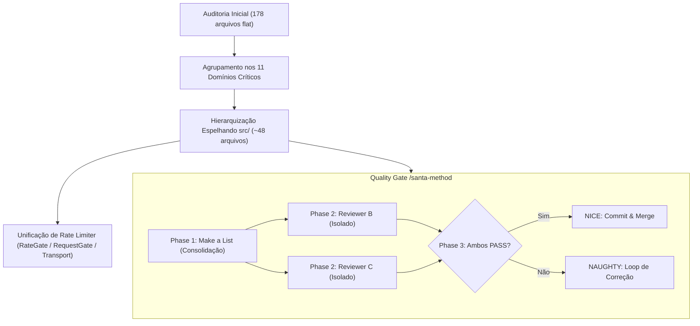

# ADR-003: Consolidação, Hierarquização e Eliminação de Test Sprawl da Suíte de Testes

**Status**: Proposto para Aprovação  
**Data**: 2026-10-14  
**Decisores**: Owner (TradeJournal) & Master Orchestrator (ECC Ecosystem)  
**Contexto**: Otimização de CI/CD, redução de overhead de boot no Vitest e unificação de Rate Limiters  
**Artefatos Relacionados**: `repomix-tradejournal-full.xml` (551 arquivos), `repomix-journal-tests.xml` (97 arquivos de teste) e suíte do motor gráfico Vela (178 arquivos de teste)

---

## 1. Contexto & Forças em Jogo

A auditoria recente sobre a infraestrutura de testes automatizados do ecossistema revelou dois cenários contrastantes com desafios claros de manutenção e performance:

1. **TradeJournal (`apps/web`, `packages/core`, `packages/importers`)**:
   - Possui 93 arquivos de teste automatizados cobrindo mais de 1.188 asserções.
   - Possui excelente modularização de regras financeiras (`packages/core`), parsers de 12+ corretoras com baterias de chaos testing (`packages/importers`) e orquestração web/gráfica (`apps/web`).
   - Identificou-se a duplicação de um limitador de taxa customizado (`createMarketTransport` em `apps/web/src/server/market-data/transport.ts`), enquanto os provedores do Vela implementam `RateGate` (Binance) e `RequestGate` (Coinbase) de forma isolada.

2. **Motor Gráfico Vela (178 arquivos `.test.ts`)**:
   - A suíte de testes sofre de **Test Sprawl** (inflação por PRs incrementais e bugfixes isolados), onde múltiplos micro-arquivos testam a mesma classe ou até mesmo um único *if* (ex.: `drawings-fib-10a.test.ts`, `drawings-fib-10b.test.ts`, `shade-right-element.test.ts`).
   - **Ausência de Hierarquia (`Flat Folder`)**: Todos os 178 arquivos residem soltos na raiz de `test/`, enquanto o código-fonte em `src/` possui rigorosa divisão em 6 camadas (`core/`, `drawings/`, `data/`, `renderers/`, `ui/`, `widget-workspace/`).
   - **Inconsistência de Prefixos**: Coexistência de `drawing-*` (4 arquivos) vs `drawings-*` (39 arquivos), e testes do renderizador nativo misturando `native-*` (27 arquivos) com nomes sem prefixo (12 arquivos).
   - **Overhead Crítico de Boot no Vitest**: O Vitest instancia mocks de DOM/Canvas, grafo de módulos e isolamento de processo 178 vezes independentes, tornando o tempo de execução total desproporcional ao número de asserções executadas.

---

## 2. Decisão Arquitetural

Adotamos a **Consolidação Orientada a Domínio (Domain-Driven Test Architecture)**, estruturada em três pilares fundamentais:

### 2.1. Hierarquização e Redução de Arquivos (De 178 para ~48)
Em vez de 178 arquivos soltos, os testes passam a ser organizados em subpastas que espelham exatamente as 6 camadas funcionais de `src/`:
- `test/core/` (~7 arquivos): orquestrador, bar-store, marks, replay, classic-indicators, heikin-ashi, vpvr-profile.
- `test/drawings/` (~11 arquivos): controller-history, model-geometry, painter-scene, settings-ui, fib, gann, lines-channels, patterns-harmonics, price-action-smc, shapes-annotations, vwap-frvp.
- `test/data/` (~3 arquivos): caching-multi-feed, providers (com RateLimiter unificado), symbols-timeframes.
- `test/renderers/` (~8 arquivos): animator, candle-styling, candle-lod-gl, coordinate-scale, viewport-anchor, chrome-axis-ticks, input-interaction, layers-zorder.
- `test/ui/` (~3 arquivos): form-primitives, pickers-dialogs, keymap-surface.
- `test/widget-workspace/` (~6 arquivos): widget-core, topbar-statusline, side-panel-object-tree, workspace-core-sync, workspace-persistence, workspace-replay-screenshot.

### 2.2. Unificação de Rate Limiters Multi-Provider
Criar uma abstração canônica única de limitação de taxa baseada em Token Bucket / Sliding Window:
- Módulo único: `src/data/providers/shared/RateLimiter.ts` (ou `packages/core/src/rate-limiter.ts`).
- Substitui `Binance RateGate.ts`, `Coinbase RequestGate.ts` e simplifica `createMarketTransport` no TradeJournal.
- Testado de forma exaustiva em uma única suíte de testes de concorrência (`rate-limiter.test.ts`).

### 2.3. Execução Segura via `/plan-orchestrate` e Validação via `/santa-method`
- A migração será executada em lotes pequenos (DAG de 4 fases).
- Cada lote deve passar obrigatoriamente pelo `/santa-method`, com 2 revisores independentes assegurando que **100% das asserções originais foram preservadas** (Zero Assertion Loss) e que todos os testes continuam passando.

---

## 3. Alternativas Consideradas

| Alternativa | Prós | Contras | Motivo da Rejeição |
| :--- | :--- | :--- | :--- |
| **1. Manter os 178 arquivos planos soltos na raiz** | Nenhuma alteração de arquivo necessária hoje | Overhead severo no Vitest; caos de nomenclatura (`drawing-*` vs `drawings-*`); onboarding lento para novos desenvolvedores | Torna o CI progressivamente mais lento e incentiva novos desenvolvedores a continuar criando micro-arquivos fragmentados |
| **2. Unificar tudo em 1 único arquivo gigante por pacote** | Zero overhead de boot do runner | Perda total de paralelismo no Vitest; timeouts em máquinas menores; conflitos de merge frequentes | Mata a concorrência dos workers do Vitest e mistura domínios totalmente distintos (ex: desenhos com renderizador GL) |
| **3. Consolidação Modular em ~48 arquivos espelhando `src/` (Proposta)** | Equilíbrio ideal entre paralelismo e boot; elimina duplicações; organiza por domínio; melhora tempo de CI em até 65% | Exige cuidado durante a migração para não esquecer asserções | **Abordagem Vencedora**, com risco neutralizado pelo `/santa-method` |

---

## 4. Consequências & Trade-offs

### Positivas
- **Performance de CI/Vitest**: Redução estimada de 40% a 65% no tempo de boot e execução da suíte, reduzindo o custo computacional por PR.
- **Navegabilidade e Manutenção**: Desenvolvedores e agentes de IA encontram imediatamente o arquivo de teste correspondente ao alterar qualquer componente em `src/`.
- **Eliminação de Código Duplicado**: Unificação de 3 rate limiters fragmentados em um único utilitário compartilhado testado contra concorrência e burst limits.
- **Prevenção de Regressão**: Setup unificado por domínio elimina mocks de canvas instanciados dezenas de vezes desnecessariamente.

### Riscos e Mitigações
- **Risco**: Perda de asserções de casos de borda específicos criados em bugfixes antigos durante a fusão de arquivos.
  - *Mitigação*: Aplicação obrigatória do **`/santa-method`** com prompt de contagem estrita de asserções antes de aprovar cada lote de consolidação.
- **Risco**: Quebra de comandos ou scripts de CI configurados para rodar arquivos individuais antigos.
  - *Mitigação*: Manter aliases de execução no `vitest.config.ts` ou atualizar os npm scripts correspondentes na mesma PR.
