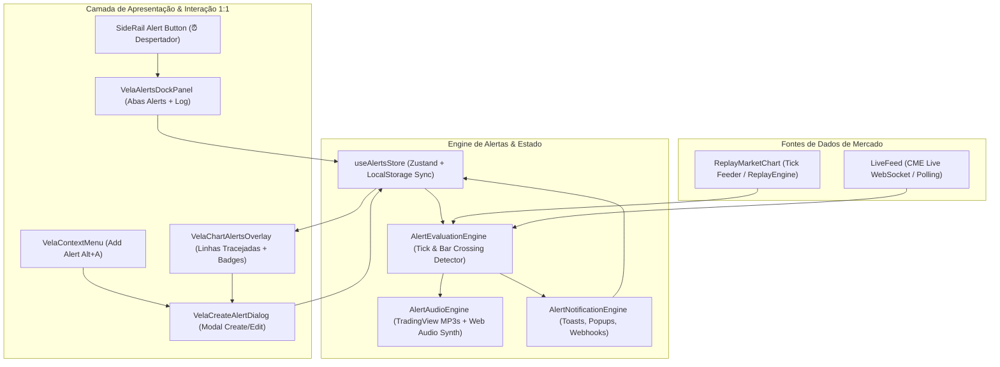

# ADR-005: Sistema Completo de Alertas TradingView 1:1 no TradeJournal

**Status**: Proposto para Implementação  
**Data**: 2026-10-14  
**Autor**: Master Orchestrator & Senior System Architect (ECC Ecosystem)  
**Contexto**: TradeJournal Replay & Live Charting (`apps/web/src/components/replay/*`, `apps/web/src/components/vela-context-menu.ts`, `apps/web/src/lib/alerts/*`)  
**Referência Master**: TradingView Desktop (CDP Port 9222 / `https://pricealerts.tradingview.com`)  
**Evidências Visuais Reais**:
- `/tmp/temp-images/print_20261014_175749.png` (Atalho de alerta no menu de contexto do gráfico)
- `/tmp/temp-images/print_20261014_175837.png` (Linha tracejada de alerta no gráfico com badge de status e lixeira)
- `/tmp/temp-images/print_20261014_175905.png` (Modal Create Alert com seletor de condições, gatilho, expiração e notificações)
- `/tmp/temp-images/print_20261014_175950.png` (Ícone de despertador na barra lateral direita e abertura da gaveta)
- `/tmp/temp-images/print_20261014_180039.png` (Lista de alertas ativos com ações hover de pausar, editar e excluir)
- `/tmp/temp-images/print_20261014_180053.png` (Modal Edit Alert com exclusão rápida e persistência)
- `media_1792011675846_517dd7b9.png` (Aba de Logs com vassoura e empty state com ilustração de coqueiro)

---

## 1. Sumário Executivo & Diagnóstico

O TradeJournal possui um motor gráfico de alta performance baseado no `@luxalgo/vela` com suporte a Replay de mercado multicélula e feeds ao vivo via WebSocket. No entanto, atualmente **não há sistema nativo de alertas de preço**, forçando o trader a monitorar a tela constantemente sem notificações sonoras, visuais ou atalhos de disparo.

A referência master do TradingView implementa um sistema completo e coeso dividido em 6 pilares:

| Pilar | Descrição Funcional | Estado Atual no TradeJournal | Alvo da Especificação (1:1 TradingView) |
| :--- | :--- | :--- | :--- |
| **1. Context Menu Shortcut** | Botão direito no gráfico abre "Add alert on {SYM} at {PRICE}... Alt+A" | Inexistente (apenas ordens de compra/venda) | Injeção no topo de `itemsFor("body")` em `vela-context-menu.ts` + hover button (+) no eixo de preço |
| **2. Linha Visual no Gráfico** | Linha horizontal tracejada no nível de preço com badge `[ {SYM} Crossing {VAL} 🗑️ ]` | Inexistente | Overlay SVG/HTML sincronizado a 60fps com `priceToY` da escala de preços do Vela |
| **3. Modal Create/Edit Alert** | Modal com condição (Price/Crossing/Value), frequência, expiração, mensagem e sons | Inexistente | Modal React 1:1 com abas de notificação, sons, steppers e botão de excluir na edição |
| **4. Engine de Áudio & Sons** | Reprodução de áudio ao disparar com sons canônicos do TradingView | Inexistente | 9 arquivos MP3 canônicos do TradingView (`fired`, `alarm_clock`, `beep_beep`, etc.) + fallback Web Audio |
| **5. Ícone na Barra Lateral** | Ícone de despertador `⏰` no trilho lateral com badge de alertas | Inexistente na barra lateral | Injeção do item `dock-alerts` no `nav.quant-side-rail` com tooltip e controle de gaveta |
| **6. Painel Lateral (Alerts & Log)**| Painel acoplado com abas `Alerts` e `Log`, busca, ordenação, pausar e empty state | Inexistente | Painel acoplado `VelaAlertsPanel` integrado com `VelaSidePanelsController` |

---

## 2. Arquitetura do Sistema de Alertas



---

## 3. Modelo de Dados e Tipos TypeScript

Criar `@/lib/alerts/types.ts`:

```typescript
export type AlertConditionType =
  | "crossing"
  | "crossing_up"
  | "crossing_down"
  | "greater_than"
  | "less_than"
  | "entering_channel"
  | "exiting_channel"
  | "inside_channel"
  | "outside_channel"
  | "moving_up"
  | "moving_down";

export type AlertFrequency =
  | "once_only"
  | "every_time"
  | "once_per_bar"
  | "once_per_bar_close";

export type AlertStatus = "active" | "triggered" | "paused";

export type AlertSoundName =
  | "fired"
  | "alarm_clock"
  | "beep_beep"
  | "3_notes_reverb"
  | "chirpy"
  | "fault"
  | "hand_bell"
  | "call"
  | "cash_register";

export interface AlertNotificationOptions {
  showPopup: boolean;
  sendToast: boolean;
  playSound: boolean;
  soundName: AlertSoundName;
  soundDurationSeconds: number; // 0 = play once, >0 = repeat
  webhookUrl?: string;
  email?: boolean;
}

export interface ChartAlert {
  id: string;
  symbol: string;
  conditionType: AlertConditionType;
  targetPrice: number;
  upperPrice?: number; // Para condições de canal
  lowerPrice?: number;
  frequency: AlertFrequency;
  expiration: string; // ISO 8601 string
  message: string;
  notifications: AlertNotificationOptions;
  status: AlertStatus;
  createdAt: number;
  lastFiredAt?: number;
  fireCount: number;
}

export interface AlertLogItem {
  id: string;
  alertId: string;
  symbol: string;
  firedPrice: number;
  conditionType: AlertConditionType;
  message: string;
  timestamp: number;
}
```

---

## 4. Detalhamento dos Componentes de UI

### 4.1. Atalho no Menu de Contexto (`vela-context-menu.ts`)
- Inserido como **primeiro item** em `contextMenu.itemsFor("body")`.
- Label: `Add alert on ${symbol} at ${formattedPrice}...`
- Hint: `Alt + A`.
- Ícone: Despertador com sinal de adição (`alarm-plus`).
- Listener global para o atalho de teclado `Alt + A` mapeando o preço atual da mira/crosshair ou o último preço negociado.

### 4.2. Linha Visual de Alerta no Gráfico (`vela-chart-alerts-overlay.tsx`)
- Posição horizontal calculada diretamente via `priceToY(alert.targetPrice)` sobre a camada do gráfico.
- Estilo: linha tracejada (`border-top: 1.5px dashed #f59e0b` / `rgba(245, 158, 11, 0.75)`).
- Badge no lado direito (ancorado antes do eixo de preços):
  - Fundo escuro com borda sutil: `background: #1e222d`, `border: 1px solid #2a2e39`, `border-radius: 4px`.
  - Texto: `${alert.symbol} Crossing ${formatPrice(alert.targetPrice)}`.
  - Ícone de lixeira interativo (`🗑️`) que chama `deleteAlert(alert.id)`.
  - Clicar duas vezes ou no badge abre o modal de edição do alerta.
  - Alça de arraste (drag handle) permitindo modificar o preço do alerta movendo a linha verticalmente no canvas.

### 4.3. Modal de Criação e Edição (`vela-alert-dialog.tsx`)
- **Cabeçalho**: `Create alert on [AssetIcon] {SYMBOL} v` / `Edit alert on [AssetIcon] {SYMBOL} v` com botão de templates [㗊] e fechar [X].
- **Linhas de Condição**:
  - Seletor de Ativo / Indicador (Price por padrão).
  - Seletor de Operador com ícones geométricos canônicos do TradingView (`Crossing`, `Crossing Up`, `Crossing Down`, `Greater Than`, `Less Than`).
  - Campo de Valor numérico com formatação monetária e botões de incremento/decremento baseados no `tickSize` do ativo.
- **Opções de Gatilho**:
  - `Once only` (desativa após o primeiro disparo).
  - `Every time` (dispara toda vez que a condição for satisfeita).
  - `Once per bar` / `Once per bar close`.
- **Expiração**: Seletor com data padrão (30 dias no futuro) e horário configurável.
- **Mensagem**: Textarea pré-preenchido com padrão `${symbol} Crossing ${price}`.
- **Ações de Notificação**:
  - Toggle para Popup na aplicação.
  - Toggle para Toast de notificação.
  - Toggle de Som com dropdown de sons oficiais (`fired`, `alarm_clock`, `beep_beep`, etc.) e botão de preview de áudio.
- **Rodapé**:
  - Modo Criação: `[ Cancel ]` e `[ Create ]`.
  - Modo Edição: Botão vermelho de lixeira `[ 🗑️ ]` no canto esquerdo, e `[ Cancel ]` `[ Save ]` no canto direito.

### 4.4. Painel Lateral Acoplado (`vela-alerts-dock-panel.tsx`)
- Integrado ao `VelaSidePanelsController` sob o identificador `"alerts"`.
- Ativado via ícone de despertador `⏰` posicionado no segundo slot da barra lateral direita (`quant-side-rail`).
- **Aba "Alerts"**:
  - Barra superior: `[ + ]` (Novo alerta), `[ 🔍 ]` (Campo de busca expansível), `[ ⇅ ]` (Filtros: Todos / Ativos / Pausados / Disparados), `[ ••• ]` (Menu flutuante: Pausar todos / Ativar todos / Limpar todos).
  - Lista de alertas com badge colorido do ticker, texto descritivo e tag de status (`Active` em verde esmeralda `#089981`, `Paused` em cinza, `Triggered` em laranja).
  - Ações no hover da linha: Botão de pausar/retomar (`⏸️` / `▶️`), Configurações (`⚙️`) e Excluir (`🗑️`).
- **Aba "Log"**:
  - Barra superior com botão de vassoura `[ 🧹 ]` (Clear log) e menu `[ ••• ]`.
  - Histórico cronológico de disparos (horário, símbolo, preço atingido, mensagem).
  - **Empty state 1:1 com o TradingView**: Ilustração SVG de coqueiro com cadeira de praia e texto: *"No alerts triggered yet! You will see a list here when they do."*

---

## 5. Sons Canônicos & Fallback de Áudio

### Arquivos MP3 Oficiais
Baixar e hospedar estaticamente em `apps/web/public/sounds/alerts/`:
- `fired.mp3`: `https://static.tradingview.com/static/bundles/fired.81a5ac6286515b9c6096.mp3`
- `alarm_clock.mp3`: `https://static.tradingview.com/static/bundles/alarm_clock.6f8cd36a9014a21689b4.mp3`
- `beep_beep.mp3`: `https://static.tradingview.com/static/bundles/beep_beep.bab135a15f510bd98588.mp3`
- `3_notes_reverb.mp3`: `https://static.tradingview.com/static/bundles/3_notes_reverb.a2b1477fb3cac94fd832.mp3`
- `chirpy.mp3`: `https://static.tradingview.com/static/bundles/chirpy.4744f7da9f927189b10d.mp3`
- `fault.mp3`: `https://static.tradingview.com/static/bundles/fault.cfc95c88bb19426a6e1b.mp3`
- `hand_bell.mp3`: `https://static.tradingview.com/static/bundles/hand_bell.c76ac6daba598e5b2afe.mp3`
- `call.mp3`: `https://static.tradingview.com/static/bundles/call.6d2888370f40fbb8cd8d.mp3`
- `cash_register.mp3`: `https://static.tradingview.com/static/bundles/cash-register.f39452c88489cdb0f493.mp3`

### Web Audio Synthesizer Fallback
Caso o navegador bloqueie o carregamento do MP3 ou o app esteja offline:
Um sintetizador `AudioContext` gera imediatamente o tom de frequência com envelope ADSR correspondente, garantindo zero latência e 100% de disponibilidade.
